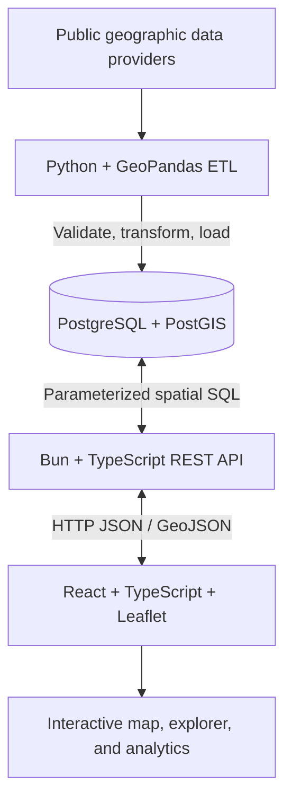

# GeoIntel

**Geospatial Intelligence & Spatial Analytics Platform**  
*An educational, portfolio-oriented full-stack Web GIS project*

> **Project status:** Early development — Phase 0 (architecture and environment). The architecture and roadmap are defined, but the full application, data pipelines, database, and map features are **not implemented yet**. Commands for future phases are labeled as planned.

GeoIntel is an interactive geographic information and decision-support platform for exploring public geographic datasets, running spatial queries, and presenting reproducible geographic analysis. The initial research theme is **urban resilience and environmental spatial analysis**, with **Miami-Dade County, Florida** as the example study area. The architecture is designed to be adaptable to other regions and subjects.

This is a **guided engineering and GIS learning project**, not a claim that the software is ready for operational emergency management, official risk assessment, or production deployment.

## Table of contents

1. [Mission and learning goals](#mission-and-learning-goals)
2. [Application scope](#application-scope)
3. [Architecture](#architecture)
4. [Technology stack](#technology-stack)
5. [Repository layout](#repository-layout)
6. [Development environment](#development-environment)
7. [Data sources and provenance](#data-sources-and-provenance)
8. [Geospatial conventions](#geospatial-conventions)
9. [API design (planned)](#api-design-planned)
10. [Testing and quality assurance](#testing-and-quality-assurance)
11. [Development roadmap](#development-roadmap)
12. [Security, privacy, and interpretation](#security-privacy-and-interpretation)
13. [Documentation and contribution workflow](#documentation-and-contribution-workflow)
14. [References](#references)

## Mission and learning goals

The purpose of GeoIntel is to build professional competence in five connected disciplines:

- **GIS fundamentals and spatial analysis:** geometry types, coordinate reference systems (CRS), map projections, spatial relationships, cartographic presentation, and geographic interpretation.
- **Geospatial software development:** interactive mapping, typed geospatial APIs, maintainable application architecture, and data visualization.
- **Spatial database engineering:** PostgreSQL/PostGIS schemas, spatial indexes, spatial SQL, query planning, and performance.
- **Geographic data engineering:** Python/GeoPandas extraction, transformation, loading (ETL), data quality, and reproducibility.
- **Software delivery:** testing, documentation, secure configuration, performance analysis, deployment, and portfolio presentation.

The primary outcome is not just an application: it is the ability to **explain, implement, test, and defend** its architectural and geographic decisions.

## Application scope

### First end-to-end vertical slice

The first demonstrable application increment will:

1. Acquire one authoritative public polygon dataset (initial candidate: Miami-Dade census tract boundaries).
2. Validate the dataset, geometry, CRS, identifiers, and provenance using Python/GeoPandas.
3. Load the processed features into PostgreSQL/PostGIS.
4. Expose a bounded, read-only GeoJSON feature endpoint through the Bun API.
5. Display geographic polygons using React and Leaflet.
6. Allow a user to select a feature and inspect its attributes.

**Important:** Census TIGER/Line boundaries contain geographic identifiers, not demographic observations. Demographic indicators require a separate source and a carefully documented join.

### Version 1 MVP — planned

| Area | Planned capability |
| --- | --- |
| Interactive map | Zoom, pan, base-map selection, feature overlays, legends, attribution, and error/loading states |
| Feature explorer | Select layers and inspect, search, and filter feature attributes |
| Spatial queries | Bounding-box filtering, nearby-feature queries, point-in-polygon, polygon intersections |
| Analytics | Feature counts, regional summaries, charts linked to map selections |
| Geographic ETL | Repeatable acquisition, validation, CRS transformation, loading, and verification |
| Export | GeoJSON and CSV where appropriate |
| Documentation | Provenance, analytical methodology, geographic assumptions, limitations, and reproducible setup |

### Later enhancements — out of scope for the initial MVP

Raster analytics, satellite imagery, remote sensing, spatial regression, spatial machine learning, extensive user management, and distributed processing are optional extensions. They will be considered **after** the core geographic workflow is reliable.

## Architecture



### Responsibility boundaries

- **React/Leaflet:** geographic presentation and interactions; no database credentials and no authoritative spatial query logic.
- **Bun API:** transport, validation, API contracts, error handling, request limits, and authorized database access.
- **PostGIS:** durable storage, spatial indexing, and database-side spatial querying.
- **Python/GeoPandas:** acquisition and batch processing of source datasets; separate execution environment from the API.

See [Initial Architecture Decision Record](docs/architecture/001-initial-architecture.md) for the rationale, tradeoffs, and alternatives.

## Technology stack

| Layer | Primary tools | Reason |
| --- | --- | --- |
| Frontend | Bun package management, TypeScript, React, Leaflet / React-Leaflet, Vite | Typed interactive geographic web application |
| API | Bun runtime, TypeScript, `Bun.serve`, Bun native `SQL` client | Minimal, maintainable HTTP and PostgreSQL integration |
| Spatial database | PostgreSQL, PostGIS, version-controlled SQL migrations | Explicit geographic storage and spatial queries |
| Processing | Python, GeoPandas, pandas, Shapely, PyProj | Reproducible geographic ETL |
| Processing/database bridge | SQLAlchemy, GeoAlchemy2, PostgreSQL driver | Transfer cleaned data to PostGIS |
| Local database services | Docker Compose | Repeatable PostGIS development environment |
| Quality | Bun test runner, pytest, SQL verification, later frontend tests | Incremental validation |

Optional libraries such as Zod, TanStack Query, and charting packages will be introduced **only when a specific feature needs them**. The API will initially avoid Express, NestJS, Prisma, and other heavy abstractions.

## Repository layout

The target structure will grow incrementally. Some directories may not exist yet.

```text
geointel/
├── apps/
│   ├── api/                      # Bun + TypeScript REST API
│   │   └── src/                  # Added in Phase 0 Lesson 0.2
│   └── web/                      # React + Leaflet (added later)
├── packages/
│   └── shared/                   # Shared TypeScript contracts as needed
├── pipelines/
│   └── geospatial/              # Python ETL scripts and tests
├── database/
│   ├── migrations/              # Ordered SQL migrations
│   └── sample-queries/          # Educational spatial SQL examples
├── data/
│   └── sample/                  # Small, redistributable development fixtures
├── docs/
│   ├── architecture/            # Architecture decision records and diagrams
│   ├── gis-concepts/            # Coordinate systems and spatial analysis notes
│   └── research-methodology/    # Sources, methodology, assumptions, limitations
├── docker-compose.yml          # Added during database setup
├── package.json                # Bun workspace root
├── bun.lock                    # Bun-generated lockfile; commit to Git
├── .env.example                # Added when config variables are introduced
├── .gitignore
└── README.md
```

The root `package.json` should declare `apps/*` and `packages/*` as Bun workspaces. Python is **not** a Bun workspace and maintains independent Python dependencies.

## Development environment

### Prerequisites

- Git
- A supported recent version of Bun (check `bun --version`)
- Python 3 with an isolated virtual environment (required once ETL begins)
- Docker and Docker Compose (required once PostGIS is introduced)
- A code editor and a terminal

For version-sensitive API behavior, consult the official references below. Do not assume all development tools have been installed or configured on every machine.

### Current setup: Phase 0 Lesson 0.1

In your local `geointel/` repository, with the root and package manifests initialized:

```bash
bun --version
python3 --version
docker compose version
git --version
bun install
git status --short
```

Expected outcomes: commands report usable versions, Bun recognizes declared workspaces, and `bun install` creates or updates `bun.lock`. Tool availability does **not** yet prove a working server or PostGIS instance.

### Phase 0 Lesson 0.2: API server (next)

After the API entry point and root scripts are added in Lesson 0.2, the intended developer workflow will be:

```bash
bun run dev:api
# In a second terminal:
curl -i http://127.0.0.1:3001/api/v1/health
```

**Not executable yet unless Lesson 0.2 has been implemented.** This endpoint initially describes **API process health only** and must not claim that PostGIS or the ETL pipeline is ready.

### Future commands (not yet available)

A future phase will document Docker Compose startup, migrations, Python environment installation, frontend execution, and full-stack tests. Do not interpret those steps as already supported by the repository.

### Configuration

- Keep secrets and machine-specific values in ignored environment files.
- Commit a safe `.env.example` when environment variables are introduced.
- Do not commit populated `DATABASE_URL` strings, credentials, API keys, or downloaded sensitive data.
- Bun reads supported `.env` files automatically during normal runtime execution; production secrets must be managed by the deployment environment.

## Data sources and provenance

### Candidate public data providers

- [U.S. Census Bureau TIGER/Line](https://www.census.gov/geographies/mapping-files/time-series/geo/tiger-line-file.html): administrative and census geographies.
- [U.S. Census data](https://data.census.gov/): demographic and socioeconomic attributes, subject to release/version and geographic compatibility.
- [FEMA National Flood Hazard Layer](https://www.fema.gov/flood-maps/national-flood-hazard-layer): mapped flood hazard information.
- [USGS](https://www.usgs.gov/): environmental, terrain, hydrographic, and related geographic data.
- Appropriate verified Miami-Dade or Florida government open-data services, evaluated on a dataset-by-dataset basis.

**Data is not yet downloaded or included.** Before use, verify actual endpoint availability, licensing, geographic coverage, currency, dataset version, and redistribution restrictions.

### Minimum provenance record

Every imported dataset should document:

| Field | Meaning |
| --- | --- |
| Dataset / version | Stable descriptive name and release identifier |
| Provider and source URL | Authoritative origin of the source material |
| Acquired on | Date the pipeline fetched the data |
| Observed / published on | When the source reflects the world, if documented |
| Original CRS | Source geographic/spatial reference system |
| Stored CRS | CRS used in GeoIntel storage |
| Geographic coverage | The region and features represented |
| License / attribution | Usage and redistribution obligations |
| Processing log | Cleaning, repair, reprojection, joins, validation |
| Limitations | Missingness, precision, vintage mismatches, analytical uncertainty |

ETL scripts should be rerunnable and produce validation summaries; synthetic development fixtures must be explicitly labeled as synthetic.

## Geospatial conventions

1. **GeoJSON positions use longitude, latitude** (for geographic coordinates), e.g. `[-80.1918, 25.7617]`. Leaflet's latitude-longitude APIs often accept the opposite order; adapters must be explicit.
2. **Never use unprojected degree coordinates as meters.** For distance-based queries choose an appropriate projected CRS or use PostGIS `geography` where appropriate.
3. **Track CRS and SRID** when importing, transforming, storing, querying, and exporting data. Setting SRID metadata does not itself transform coordinates.
4. **Validate geographic inputs** (coordinate ranges, bounds, polygon validity, search radius, and feature counts).
5. **Index suitable spatial columns** (e.g. GiST) and examine query plans when datasets grow.
6. **Define boundary semantics explicitly:** `ST_Contains`, `ST_Within`, and `ST_Intersects` are not interchangeable, particularly for features lying on polygon boundaries.
7. **Document statistical meaning:** spatial overlap is not equivalent to exposure, vulnerability, or actual risk.
8. **Preserve provenance** for every dataset and derived analytical result.

## API design (planned)

Base prefix: `/api/v1`. The following are educational target contracts, **not implemented endpoints**.

| Method | Route | Intended purpose |
| --- | --- | --- |
| GET | `/api/v1/health` | Basic API-process liveness |
| GET | `/api/v1/datasets` | Available dataset metadata |
| GET | `/api/v1/datasets/:id` | One dataset's metadata and limitations |
| GET | `/api/v1/features?datasetId=...&bbox=...` | Bounded geographic feature retrieval |
| GET | `/api/v1/features/:id` | Selected feature metadata/geometry |
| GET | `/api/v1/nearby?lat=...&lon=...&radiusMeters=...` | Distance-constrained geographic query |
| POST | `/api/v1/analysis/intersections` | Polygon intersection analysis |
| GET | `/api/v1/statistics?datasetId=...` | Summary statistics |

Working contracts will ultimately specify request/response schemas, pagination, upper limits, coordinate order, invalid-input behavior, error shapes, and projection assumptions. API consumers will access geographic data as GeoJSON `Feature`/`FeatureCollection` where appropriate.

## Testing and quality assurance

Automated testing will grow in each development phase; the following is the **target strategy**, not existing coverage:

- **Bun unit tests:** routing helpers, validation, serialization, and service behavior.
- **API integration tests:** endpoints, response contracts, status codes, and negative cases.
- **PostGIS tests:** SRIDs, geometry validity, spatial predicates, index use, and known fixtures.
- **Python `pytest` tests:** ETL transformations, coordinate conversions, missing attributes, and import validation.
- **Frontend tests:** map interaction and visualization state, introduced when useful.
- **System verification:** load a known fixture through the full pipeline and compare expected results.

Important edge cases include invalid coordinates, missing/incorrect CRS, invalid or empty geometries, excessive radius or bounding boxes, empty matches, and geographic boundary behavior.

## Development roadmap

Progress is assessed on **demonstrated code and verified behavior**, not on elapsed time or a claimed completion percentage.

| Phase | Focus | Status |
| --- | --- | --- |
| 0 | Architecture and development environment | In progress |
| 1 | GIS and geospatial fundamentals | Planned |
| 2 | Spatial database engineering | Planned |
| 3 | Python geospatial ETL | Planned |
| 4 | Bun REST API and database integration | Planned |
| 5 | React and Leaflet integration | Planned |
| 6 | Interactive spatial query tools | Planned |
| 7 | Analytical dashboards | Planned |
| 8 | Multi-dataset urban resilience analysis | Planned |
| 9 | Testing and geographic QA | Planned |
| 10 | Performance, security, and reliability | Planned |
| 11 | Deployment and professional portfolio | Planned |
| 12 | Optional raster, remote sensing, and spatial ML | Optional |

Even though dedicated testing is listed as Phase 9, **each phase** will have verification and acceptance criteria.

## Security, privacy, and interpretation

- Use authoritative or otherwise defensibly sourced **public** geographic data.
- Never expose Postgres credentials to browsers or permit arbitrary SQL from clients.
- Apply parameterized SQL, input validation, query limits, reasonable rate limits, and least-privilege access as appropriate.
- Avoid unnecessary collection or publication of precise personal location data.
- Treat aggregated demographics responsibly; do not infer sensitive individual characteristics from where someone lives.
- Clearly differentiate observation, spatial overlap, modeled estimates, and causal claims.
- GeoIntel is an educational analytical tool, **not an official disaster-risk model or a substitute for emergency planning guidance**.

## Documentation and contribution workflow

Major decisions should be described in `docs/architecture/` with context, alternatives, consequences, and review triggers. GIS lessons and research methods should be recorded separately. Feature changes should ideally include relevant tests and documentation updates.

A suggested Git style is `type(scope): short imperative summary`, for example:

```text
chore(repo): initialize Bun workspaces
feat(api): add liveness endpoint
test(api): cover health response
chore(db): add first spatial schema migration
docs(architecture): record spatial query ownership
```

Do not mark a phase complete until its essential deliverables and tests are reviewed.

## References

- [Bun workspaces](https://bun.com/docs/pm/workspaces)
- [Bun HTTP server](https://bun.com/docs/runtime/http/server)
- [Bun routing](https://bun.com/docs/runtime/http/routing)
- [Bun native SQL](https://bun.com/docs/runtime/sql)
- [Bun test runner](https://bun.com/docs/test)
- [GeoJSON specification — RFC 7946](https://www.rfc-editor.org/rfc/rfc7946)
- [PostGIS documentation](https://postgis.net/documentation/)
- [GeoPandas documentation](https://geopandas.org/en/stable/)
- [U.S. Census TIGER/Line](https://www.census.gov/geographies/mapping-files/time-series/geo/tiger-line-file.html)

---

**Learning philosophy:** Explain the geographic and software engineering rationale, build one verified increment at a time, review the implementation, and only then add complexity.

