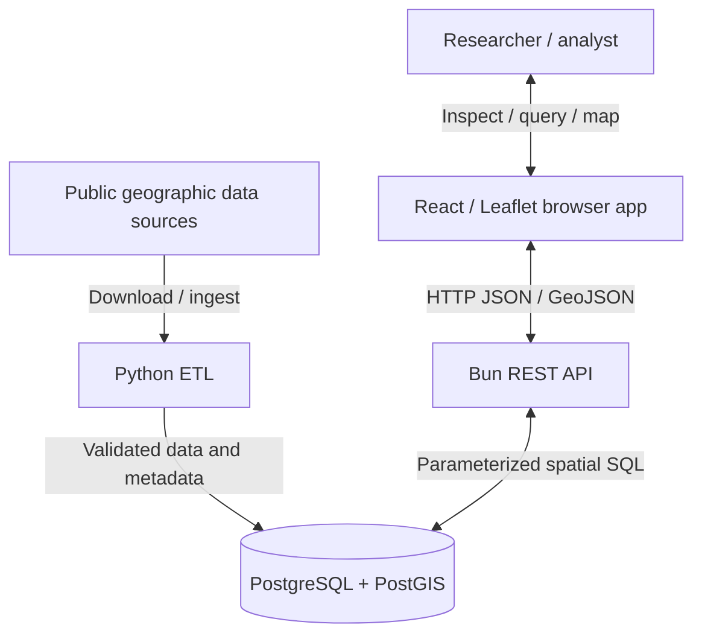
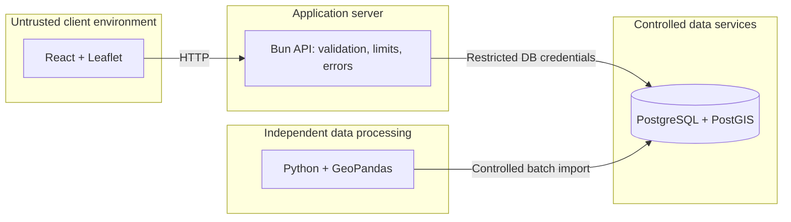
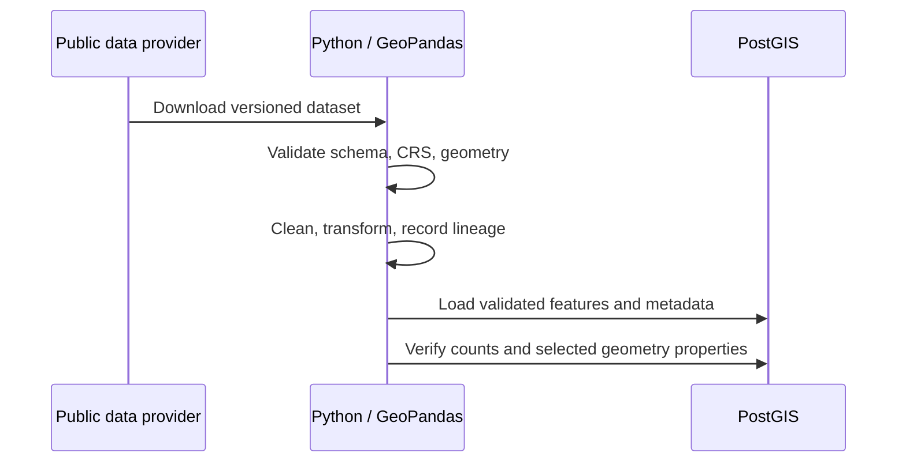
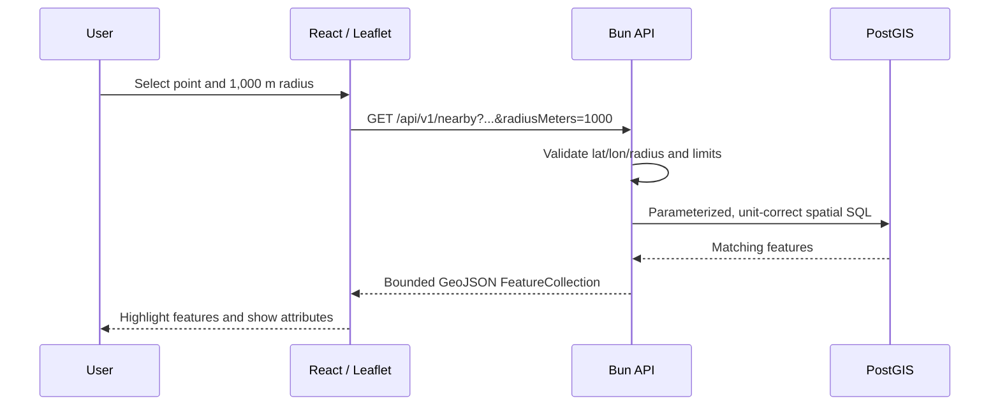

# ADR-001: Initial GeoIntel Architecture

- **Status:** Accepted as the initial *design direction*; implementation and runtime behavior remain unverified
- **Date:** 2026-11-01
- **Decision owners:** GeoIntel project development
- **Scope:** Initial MVP and educational development architecture
- **Related:** [`README.md`](../../README.md)

## 1. Context and problem statement

GeoIntel is a full-stack geographic information and spatial analytics platform intended to teach professional Web GIS development through a real, reproducible project. The first study area is Miami-Dade County, Florida; the initial domain is urban resilience and environmental spatial analysis.

The system must ingest public geographic datasets, maintain their provenance, store valid spatial features, support efficient geographic searches, and return geographic results to an interactive web map. It must also be small enough to build, reason about, and test incrementally.

The application crosses several distinct disciplines: browser-based geographic interaction, HTTP API design, spatial database engineering, and reproducible GIS data processing. A single undifferentiated application would make these responsibilities harder to test and could conceal geographically incorrect calculations.

### Drivers

1. Maintain a **TypeScript-first** application stack, while retaining Python for scientific/geospatial data processing.
2. Learn **actual PostGIS spatial SQL** rather than abstracting it behind a heavy ORM.
3. Preserve reproducible data lineage, geometry validation, and CRS documentation.
4. Prioritize security of database credentials and control expensive spatial queries.
5. Deliver a functional **vertical slice** before adding advanced analytics.
6. Keep development and hosting complexity proportionate to an educational portfolio project.

### Constraints and assumptions

- Frontend: React, TypeScript, Leaflet/React-Leaflet; Bun for package management; Vite is permitted.
- API: Bun runtime, TypeScript, `Bun.serve`, native Bun PostgreSQL `SQL` client.
- Spatial persistence: PostgreSQL with PostGIS and explicit SQL migrations.
- Batch ETL: Python and GeoPandas with independent Python dependency management.
- Initial local database: Docker Compose.
- Data sources must be accessible and suitable for lawful research, with license and metadata verification.
- No user authentication, upload service, background job broker, or raster processing is required for the first slice.
- Actual software and container compatibility must be verified on the developer's machine; this record is a design decision, not a test report.

## 2. Decision summary

**Adopt a modular monorepo with four execution components:**

1. A **React + TypeScript + Leaflet** browser application for visual exploration and map interactions.
2. A **Bun + TypeScript REST API** as the only browser-facing data-access boundary.
3. A **PostgreSQL + PostGIS** database to store geographic data and perform repeated, efficient spatial SQL queries.
4. A separate **Python + GeoPandas ETL** environment to acquire, validate, transform, and load external geographic datasets.

Use a shared Git repository and Bun workspaces only for TypeScript packages. The Python pipeline is in the same Git repository but **not** in the Bun workspace dependency graph.

### System context

### Trust and execution boundaries

Client-side geographic selection is **not** equivalent to an authoritative database query. The browser receives only data authorized and bounded by the API. Browser code never receives database credentials.

## 3. Detailed component decisions

### 3.1 Frontend — React, TypeScript, Leaflet

**Responsibilities**

- Render base maps and GeoJSON overlays with attribution.
- Manage viewport, visibility, feature selection, and UI state.
- Make typed HTTP requests and report loading, empty, and error states.
- Present selected geographic attributes, statistics, and explanations.
- Support export workflows, subject to API and data licensing constraints.

**Non-responsibilities**

- Raw database connections or credentials.
- Arbitrary SQL or authoritative large-scale spatial joins in the browser.
- Hidden changes to CRS assumptions or geographic measurement units.

**Why:** React is already familiar to the developer, Leaflet is appropriate for the initial vector maps, and a small UI layer makes the relationship between API responses and geographic displays easier to understand.

**Tradeoff:** Rendering many detailed polygons as ordinary GeoJSON can become expensive in the browser. We will first add bounding-box requests, reasonable result limits, simplification when justified, and later evaluate vector tiles if real performance evidence warrants them.

### 3.2 Backend — Bun, TypeScript, `Bun.serve`

**Responsibilities**

- Define versioned REST endpoints and response contracts.
- Validate coordinates, bounding boxes, feature identifiers, pagination, and distance units.
- Execute parameterized SQL through Bun's native `SQL` client.
- Control query size and shape, expose safe error responses, and manage configuration.
- Return standard JSON and GeoJSON; attach relevant metadata as contracts evolve.

**Non-responsibilities**

- Downloading and cleaning entire public datasets on each request.
- Performing all spatial computation with TypeScript loops when indexed PostGIS queries are appropriate.
- Replacing the GIS-specific batch processing role of Python.

**Why:** Bun reduces API framework overhead and lets us learn the native HTTP Request/Response model and PostgreSQL queries directly.

**Tradeoff:** Framework-level conventions for routing, validation, and error handling must be established deliberately. Begin with small modules and introduce additional libraries only when they solve observed problems.

**Lesson 0.2 note:** The initial health endpoint tests **API process liveness**, not end-to-end readiness. Do not label it a successful database health check until one is actually implemented.

### 3.3 Database — PostgreSQL + PostGIS

**Responsibilities**

- Persist geographic feature geometry and attributes.
- Maintain dataset/source/version/CRS metadata.
- Apply schema constraints and spatial indexes where appropriate.
- Run indexed spatial predicates and spatial aggregation.
- Serialize geometry to GeoJSON for API output.

**Why:** PostGIS supports authoritative spatial computations near the stored data, where indexing and query planning can improve repeated interactive workloads.

**Tradeoff:** Spatial SQL requires CRS awareness, geometry validity checks, query explain plans, and explicit handling of distance/area units. These are essential learning outcomes, not incidental complexity.

### 3.4 Data engineering — Python + GeoPandas

**Responsibilities**

- Retrieve input files or datasets from verified sources.
- Inspect geometry type, source CRS, attributes, missingness, and identifiers.
- Repair or reject invalid records with documented rules.
- Reproject where required and record transformations.
- Load or update cleaned geographic data in PostGIS.
- Produce reproducible validation reports and ingestion metadata.

**Why:** GeoPandas, Shapely, and PyProj provide a productive research-oriented environment for batch geospatial processing and inspection.

**Tradeoff:** Python operations may be slower or more memory-intensive for large datasets. Prefer PostGIS for repeated indexed searches on persisted data; use batch tools for acquisition and transformations that are more appropriate outside interactive requests.

**Important distinction:** GeoPandas and PostGIS have overlapping spatial operations. Responsibility is allocated by workload, latency, data locality, reproducibility, and resource costs—not by a rigid prohibition on particular spatial functions.

## 4. End-to-end data flows

### 4.1 Dataset ingestion flow

Ingestion is explicitly triggered and can be repeated with recorded source versions and transformation parameters. Failures should be observable and should not silently leave a dataset appearing current when the import was incomplete.

### 4.2 Interactive spatial search flow

The API should specify that request `lon` is longitude, `lat` is latitude, and `radiusMeters` is a metric distance. A proximity query using EPSG:4326 `geometry` units directly would be geographically wrong if its radius were interpreted as meters; select `geography` or an appropriate projected CRS instead.

## 5. Data model direction (not yet implemented)

At the MVP stage, we expect at least these logical records:

- **Dataset metadata:** dataset identifier, provider, source URL, license, acquisition date, geographic and temporal coverage, original/stored CRS, known limitations.
- **Geographic features:** source identifier, attributes, geometry with a known SRID, and a relationship to dataset metadata.
- **ETL ingestion records:** source version, processing method, timestamps, counts, validation issues, and import status.

The exact SQL schema will be designed and migrated in Phase 2, following inspection of our chosen real data. Avoid inventing final table structures before inspecting geometry types, identifier uniqueness, or source metadata.

### Minimum geographic integrity principles

- Explicit geometry type and appropriate SRID constraints, where possible.
- Correct handling of empty and invalid geometry.
- Preserve source IDs and dataset versions.
- GeoJSON API output in a clearly specified CRS convention.
- Spatial index strategy based on observed queries and `EXPLAIN ANALYZE`.
- Consider points lying on polygon boundaries when selecting spatial predicates.
- Avoid transformations that overwrite original coordinates without documentation.

## 6. API contract direction (not implemented)

The API uses the versioned prefix `/api/v1`. Proposed endpoints:

| Endpoint | Responsibility |
| --- | --- |
| `GET /api/v1/health` | Initial liveness of the HTTP process |
| `GET /api/v1/datasets` | List accessible dataset metadata |
| `GET /api/v1/datasets/:id` | Dataset details, provenance, limitations |
| `GET /api/v1/features` | Spatially bounded features and attribute filters |
| `GET /api/v1/features/:id` | Specific feature details |
| `GET /api/v1/nearby` | Metric proximity search |
| `POST /api/v1/analysis/intersections` | Controlled polygon intersection |
| `GET /api/v1/statistics` | Geographic statistical summaries |

Before implementation, define query limits, error handling, response geometry size, pagination, coordinate order, and compatibility expectations. Prefer explicit response schemas to ad hoc data shapes. For the first liveness endpoint, avoid premature database dependencies.

## 7. Alternatives considered

| Alternative | Reason not chosen initially | When to reconsider |
| --- | --- | --- |
| Separate Git repositories | Additional coordination and shared-contract overhead during a learning project | Independent teams, governance, or release lifecycles |
| Single Bun process doing all ETL | Mixes long-running batch jobs with latency-sensitive requests | Only for small ad hoc synchronous transformations |
| Python/FastAPI as the primary API | Duplicates the selected TypeScript learning focus | If extensive Python-native online inference becomes the primary requirement |
| ORM-first PostGIS access | Conceals useful spatial SQL and query execution details | After direct SQL becomes difficult to maintain at larger scale |
| Browser-direct Postgres | Exposes credentials/trust boundary; poor control of queries | Not appropriate for this architecture |
| GIS server or vector tile stack at launch | Adds operating complexity before a proven performance need | Large datasets or cartographic requirements exceed GeoJSON/Leaflet capabilities |
| Kubernetes/microservices | Adds cost and orchestration complexity without an initial need | Significant scaling, multi-team ownership, or isolation requirements |

## 8. Nonfunctional requirements and planned verification

| Concern | Design principle | How it will be verified |
| --- | --- | --- |
| Correctness | CRS and distance units documented at every boundary | Known coordinate and distance fixtures |
| Security | DB secrets stay server-side; parameters validated | Negative endpoint tests and code review |
| Performance | Bounded queries, GiST indexes where useful | `EXPLAIN ANALYZE` and response-size checks |
| Reproducibility | Versioned source, transformations, and migrations | Rerun ETL on known inputs |
| Maintainability | Small modules, explicit contracts | Review and incremental refactoring |
| Reliability | Errors surfaced; failed imports distinguishable | Failure-injection and health checks as needed |
| Accessibility/usability | Usable map controls and clear data limitations | Frontend interaction and usability checks |

No tests are represented as already passing by this design document.

## 9. Security, ethics, and research integrity

- Favor legitimate public-interest geographic analysis and verified public data.
- Minimize collection of precise personal location information.
- Do not infer sensitive characteristics about individuals from neighborhood-level aggregates.
- Record missingness, geographic and temporal mismatches, uncertainty, and limitations.
- Do not conflate **geographic overlap**, **potential exposure**, **vulnerability**, and **actual disaster risk**.
- Avoid describing exploratory outputs as authoritative emergency-management guidance.
- Enforce database least privilege, input validation, parameterized SQL, and resource bounds in later API phases.

## 10. Consequences

### Positive

- Strong separation of concerns with a clear data path.
- A realistic learning environment for full-stack and GIS engineering.
- Efficient geospatial searches can be implemented close to persistent data.
- Python workflows remain reproducible independently of interactive API requests.
- A single Git history captures coherent project milestones.

### Costs and risks

- Multiple runtimes and dependency managers need deliberate documentation.
- Incorrect CRS assumptions may produce plausible but wrong answers.
- Public data licensing, schema changes, and release vintage can complicate ingestion.
- Serving extensive GeoJSON polygons can harm client performance.
- The native Bun stack requires our own project conventions for validation and errors.

### Mitigations

Use small vertical slices, explicit acceptance tests, pinned dependencies and database images where feasible, dataset provenance records, safe API defaults, and performance measurement before adding infrastructure.

## 11. Incremental implementation sequence

1. **Phase 0.1:** Create Git repository, Bun workspaces, documentation. Verify tool availability.
2. **Phase 0.2:** Start a minimal Bun HTTP server and test a liveness endpoint. No DB dependency.
3. **Later Phase 0:** Initialize React app and PostGIS container separately.
4. **Phase 1:** Complete geographic coordinates, geometry, CRS, and GeoJSON exercises.
5. **Phase 2:** Define PostGIS schema and spatial SQL migrations.
6. **Phase 3:** Acquire, validate, and import a real polygon dataset using Python/GeoPandas.
7. **Phase 4:** Add PostGIS-backed REST data endpoints.
8. **Phase 5:** Display and explore features using React/Leaflet.
9. **Phases 6–11:** Add query tools, analysis, tests, optimization, deployment, and portfolio materials.

**First full vertical-slice acceptance criterion:** A user can load a real geographic dataset through GeoPandas → PostGIS → Bun → Leaflet and inspect a selected feature, with geographic provenance and coordinate order documented.

## 12. Open questions and review triggers

The following are **not decided yet**:

- Developer machine OS/architecture and concrete versions of installed tools.
- Exact dataset release and geographic extent for the first ETL pipeline.
- Whether to store both raw source data and normalized features in PostGIS.
- Exact schema, migration runner, typed contracts, and data export limits.
- Production hosting, backups, deployment method, and operating budget.
- Index/query strategy for actual data sizes and selected analyses.

Revisit ADR-001 when empirical evidence shows a key assumption is false: e.g. browser geometry performance becomes limiting, PostGIS query plans prove inadequate, a data source imposes licensing constraints, or a new workflow requires secure background processing.

## 13. References

- [Bun HTTP server](https://bun.com/docs/runtime/http/server)
- [Bun routing](https://bun.com/docs/runtime/http/routing)
- [Bun SQL client](https://bun.com/docs/runtime/sql)
- [Bun workspaces](https://bun.com/docs/pm/workspaces)
- [Bun testing](https://bun.com/docs/test)
- [GeoJSON — RFC 7946](https://www.rfc-editor.org/rfc/rfc7946)
- [PostGIS documentation](https://postgis.net/documentation/)
- [GeoPandas documentation](https://geopandas.org/en/stable/)
- [Census TIGER/Line shapefiles](https://www.census.gov/geographies/mapping-files/time-series/geo/tiger-line-file.html)

---

**ADR status interpretation:** We have accepted this initial architectural direction for the educational project. Acceptance of a design does **not** establish that the software has been implemented, tested, secured, or deployed.

